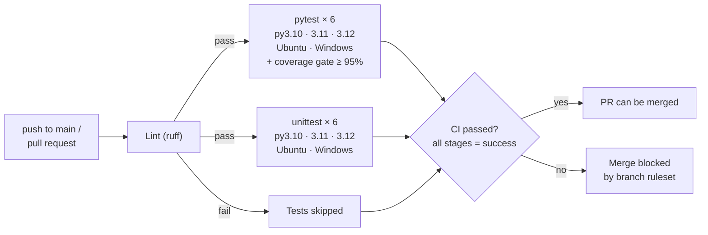
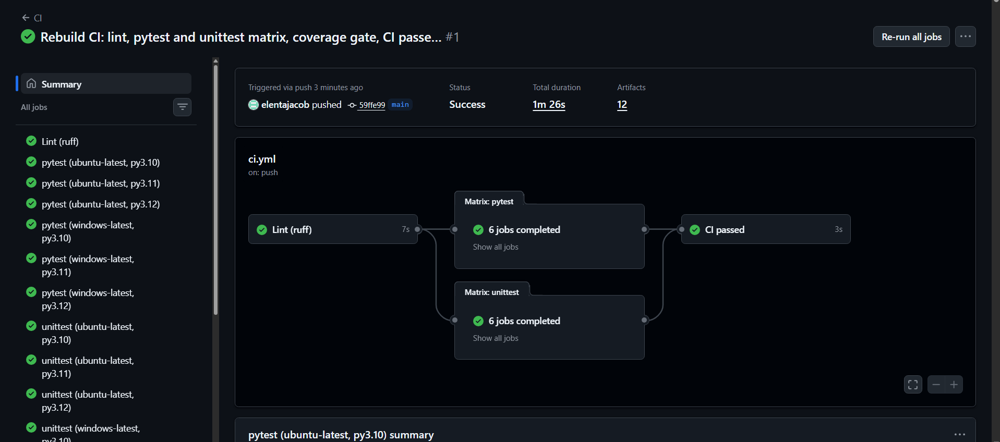
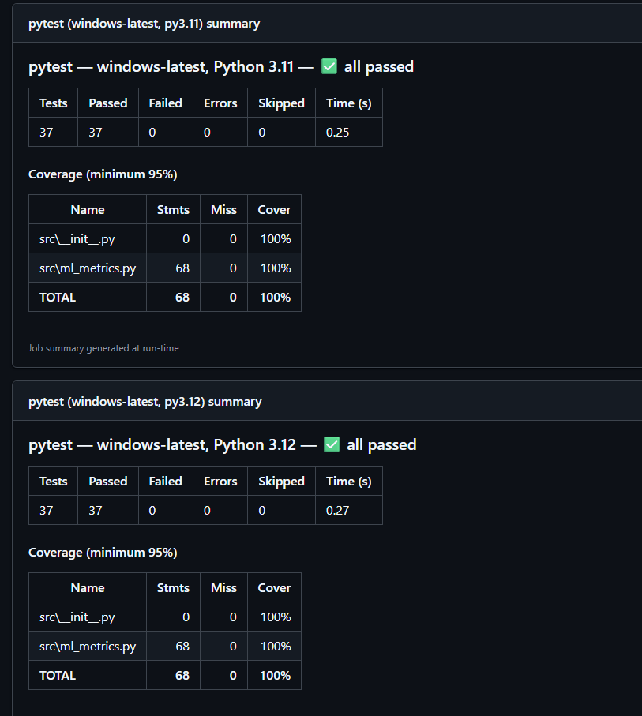
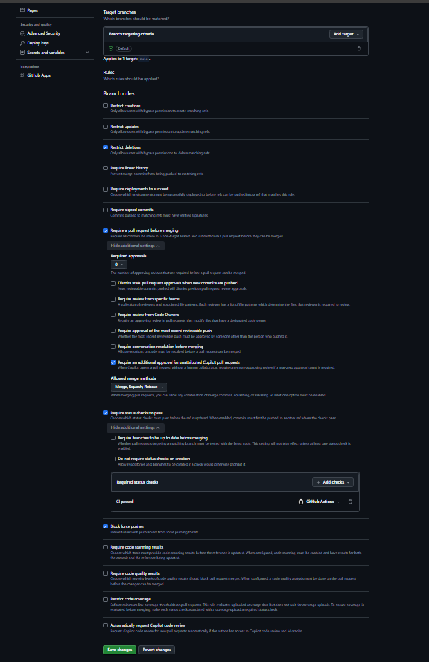
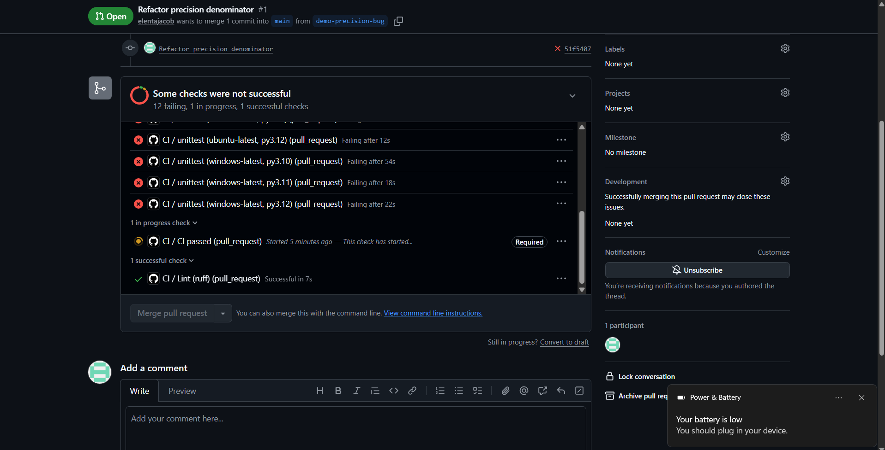
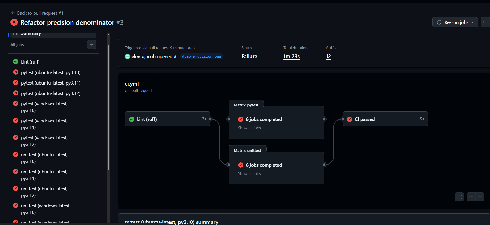
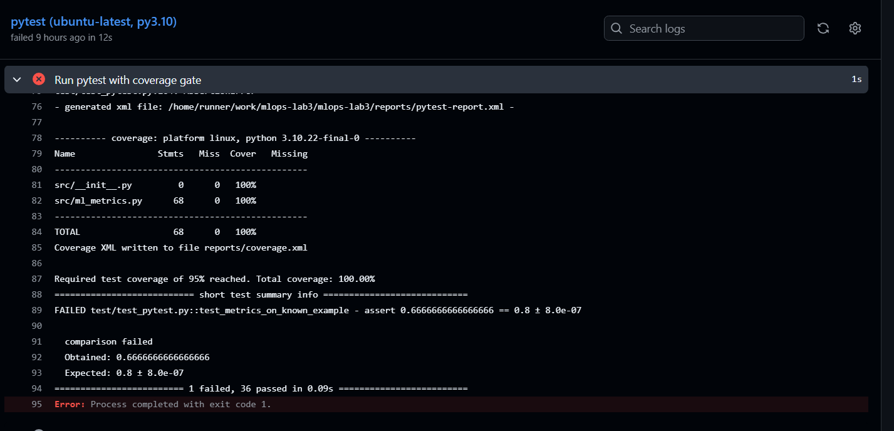

# MLOps Lab 3 — Continuous Integration with GitHub Actions, pytest & unittest

[](https://github.com/elentajacob/mlops-lab3/actions/workflows/ci.yml)

**Author:** Elenta Jacob · M.S. Data Science, Northeastern University (Khoury College)

Every push and every pull request runs a CI pipeline that **lints** the code, runs the **pytest** and **unittest** suites on **3 Python versions × 2 operating systems**, enforces a **coverage gate**, and reports a single **"CI passed"** check. The `main` branch is protected: a change can only be merged if that check is green.

Based on GitHub Lab 1 from the course repository. The CI pipeline was rebuilt, and the code and both test suites were replaced. All changes are listed below.

---

## Table of Contents

1. [What I Changed — CI Pipeline](#1-what-i-changed--ci-pipeline)
2. [What I Changed — Code & Tests](#2-what-i-changed--code--tests)
3. [How the Pipeline Works](#3-how-the-pipeline-works)
4. [Branch Protection & the Pull Request Demo](#4-branch-protection--the-pull-request-demo)
5. [Results](#5-results)
6. [Run It on GitHub (no installation needed)](#6-run-it-on-github-no-installation-needed)
7. [Run It on Your Own Computer](#7-run-it-on-your-own-computer)
8. [What a Successful Run Looks Like](#8-what-a-successful-run-looks-like)
9. [Design Decisions](#9-design-decisions)
10. [Troubleshooting](#10-troubleshooting)
11. [Screenshots](#11-screenshots)

---

## 1. What I Changed — CI Pipeline

This is the core of the lab. The original two workflows **no longer run at all**:

- `pytest_action.yml` has a typo (`run-nam:`) and uses both `branches` and `branches-ignore` on the same `push` trigger, which GitHub rejects as an invalid workflow.
- Both workflows use `actions/upload-artifact@v2` and `setup-python@v2`. GitHub has shut down artifact actions v2/v3, so the upload step fails.
- Both pin Python 3.8, which is end-of-life.
- They live in a `workflows/` folder, which GitHub ignores; only `.github/workflows/` is executed.

| | Original Lab | My Version |
|---|---|---|
| **Workflow files** | Two separate one-job workflows (`pytest_action.yml`, `unittest_action.yml`) | One staged pipeline, `.github/workflows/ci.yml` |
| **Stages** | Single job each | **Lint → pytest + unittest in parallel → "CI passed" gate** (jobs linked with `needs:`) |
| **Linting** | None | **ruff** runs first; test jobs only start if lint passes |
| **Environments** | Python 3.8 on Ubuntu | **Matrix: Python 3.10, 3.11, 3.12 × Ubuntu and Windows**, 6 environments per suite (12 test jobs), `fail-fast: false` so every failure is reported |
| **Coverage** | None | **pytest-cov with a coverage gate**: the build fails if coverage of `src/` drops below `COVERAGE_MIN` (95%) |
| **Pull requests** | Not checked | Every PR into `main` runs the full pipeline |
| **Merge protection** | None | A **ruleset on `main`** requires a pull request and a green **"CI passed"** check; failing PRs cannot be merged |
| **Single required check** | n/a | `ci-passed` job aggregates all stages, so branch protection needs only one check name instead of 13 |
| **Results** | Plain logs; `echo` success/failure messages | **Job summaries**: test count table (passed/failed/errors/time), coverage table, list of failing tests, and a final stage-by-stage CI result table |
| **Artifacts** | `upload-artifact@v2` (now broken) | JUnit XML, coverage XML and unittest logs uploaded from **every** environment with `upload-artifact@v6`, even on failure |
| **Triggers** | `push` (plus an invalid `label`/`issues` config) | `push` to `main` with **path filters** (only code/test/CI changes), every `pull_request`, and a manual **Run workflow** button |
| **Efficiency** | None | **pip caching**, and **concurrency** cancels outdated runs on the same branch |
| **Security** | Implicit permissions | Explicit read-only `permissions: contents: read` |
| **Cross-platform** | Linux only | `shell: bash` on every OS for identical behaviour; job-summary script forces UTF-8 so status symbols render on Windows |
| **Action versions** | `checkout@v2`, `setup-python@v2`, `upload-artifact@v2` (Node 12/16, retired) | `checkout@v5`, `setup-python@v6`, `upload-artifact@v6` (Node 24) |
| **Dependencies** | `pytest` unpinned | All tools **pinned** in `requirements.txt` |

## 2. What I Changed — Code & Tests

| | Original Lab | My Version |
|---|---|---|
| **Code under test** | `calculator.py`: 4 arithmetic functions (`fun4` has no input check, so `fun4("a","b","c")` returns `"abc"`) | `ml_metrics.py`: 10 ML statistics and classification metrics with full input validation |
| **Functions** | add, subtract, multiply, add-three | `mean`, `variance` (population & sample), `std`, `z_scores`, `min_max_scale`, `confusion_matrix`, `accuracy`, `precision`, `recall`, `f1_score` |
| **Error handling** | `ValueError` for non-numbers in 3 of 4 functions | Clear `TypeError`/`ValueError` for empty input, non-numeric values, booleans, mismatched label lengths, non-binary labels, invalid scaling ranges; documented zero-division behaviour (returns 0.0, like scikit-learn) |
| **pytest suite** | 4 tests | **37 test cases** using `@pytest.mark.parametrize`, fixtures, `pytest.raises(match=...)`, `pytest.approx` |
| **unittest suite** | 4 tests, `sys.path` hack | **14 tests** in 3 `TestCase` classes, using `subTest`, `setUp`, `assertRaises`, `assertAlmostEqual`; no path hacks (run with `-t .`) |
| **Coverage** | Not measured | **100%** line coverage of `src/` |
| **Repo hygiene** | No `.gitignore`; empty `data/` placeholder | `.gitignore` for venvs, caches and reports; unused `data/` removed |

---

## 3. How the Pipeline Works



### Repository structure

```
mlops-lab3/
├── .github/
│   ├── workflows/ci.yml          # The CI pipeline (lint -> test matrix -> CI passed)
│   └── scripts/junit_summary.py  # Turns JUnit XML into job-summary tables
├── src/
│   ├── __init__.py
│   └── ml_metrics.py             # Code under test: statistics + classification metrics
├── test/
│   ├── __init__.py
│   ├── test_pytest.py            # 37 pytest cases
│   └── test_unittest.py          # 14 unittest tests
├── screenshots/                  # Evidence of pipeline runs
├── requirements.txt              # Pinned tool versions
└── .gitignore
```

---

## 4. Branch Protection & the Pull Request Demo

`main` is protected by a repository **ruleset** (Settings → Rules → Rulesets → `protect-main`):

| Rule | Effect |
|---|---|
| Require a pull request before merging (0 approvals) | No direct pushes to `main`; every change goes through a PR |
| Require status checks to pass: **CI passed** | A PR can only be merged when the whole pipeline is green |
| Block force pushes, Restrict deletions | `main`'s history can't be rewritten or deleted |
| Bypass list: empty | The rules apply to the repository owner too |

**Demo (PR #1, closed without merging):** I opened a pull request titled *"Refactor precision denominator"* that changed one line in `precision()`, dividing by `TP + FN` instead of `TP + FP` (a realistic precision/recall mix-up).

- **Lint passed:** the code was syntactically fine.
- **All 12 test jobs failed** on every Python version and OS. pytest pinpointed the bug: `test_metrics_on_known_example` expected precision **0.8** but got **0.667** (the recall value).
- **CI passed failed**, so GitHub **blocked the merge**. The PR was closed and the bug never reached `main`.

**Lesson from the demo:** coverage stayed at **100%** while the code was wrong. Coverage only shows code was *executed*; it takes assertions against known correct values to catch wrong *results*. The pipeline enforces both.

---

## 5. Results

| Check | Result on `main` |
|---|---|
| Lint (ruff) | Passed, no issues |
| pytest | **37 / 37 passed** on all 6 environments |
| unittest | **14 / 14 passed** on all 6 environments |
| Coverage of `src/` | **100%** (gate: 95%) |
| CI passed | All stages succeeded |
| Total pipeline time | About 1.5 minutes (14 jobs, test jobs run in parallel) |

---

## 6. Run It on GitHub (no installation needed)

You only need a free GitHub account and a web browser.

1. **Fork** this repository (Fork button, top-right).
2. Go to the **Actions** tab and click **I understand my workflows, go ahead and enable them**.
3. Click **CI → Run workflow → Run workflow**. (Pushing a change to `src/`, `test/`, `requirements.txt` or `.github/` also starts it.)
4. Wait about 1.5 minutes. Open the run to see the job graph, and scroll down for the summary tables.
5. **Optional, to reproduce the branch protection:** Settings → Rules → Rulesets → New branch ruleset → target the default branch → tick *Require a pull request before merging* and *Require status checks to pass* → add the check **CI passed** → Create. Then open a PR that breaks a test and watch the merge get blocked.

No secrets or cloud accounts are needed.

---

## 7. Run It on Your Own Computer

### 7.1 Install the prerequisites

| Tool | Version | Where to get it |
|---|---|---|
| **Python** | **3.10, 3.11 or 3.12** (the versions CI tests) | https://www.python.org/downloads/ — on Windows, tick **"Add python.exe to PATH"** during installation |
| **Git** | Any recent version (tested with 2.52) | https://git-scm.com/downloads |

Check both are installed by opening a terminal (Windows: **Command Prompt**; macOS: **Terminal**):

```bash
python --version      # should print Python 3.10.x, 3.11.x or 3.12.x   (macOS: python3 --version)
git --version
```

### 7.2 Get the code

```bash
git clone https://github.com/elentajacob/mlops-lab3.git
cd mlops-lab3
```

### 7.3 Create a virtual environment and install dependencies

**Windows (Command Prompt):**
```bat
python -m venv venv
venv\Scripts\activate
pip install -r requirements.txt
```

**macOS / Linux:**
```bash
python3 -m venv venv
source venv/bin/activate
pip install -r requirements.txt
```

Your prompt now starts with `(venv)`. Pinned versions:

| Package | Version | Used for |
|---|---|---|
| pytest | 8.3.3 | Running the pytest suite |
| pytest-cov | 5.0.0 | Measuring coverage during pytest |
| coverage | 7.6.1 | Coverage engine and Markdown coverage report |
| ruff | 0.6.9 | Linting |

(`unittest` is part of Python's standard library, so nothing extra is needed.)

### 7.4 Run each CI stage locally

Run these from the repository root, the folder containing `requirements.txt`:

**Lint:**
```bash
ruff check .
```

**pytest with the coverage gate:**
```bash
python -m pytest test/test_pytest.py -v --cov=src --cov-report=term-missing --cov-fail-under=95
```

**unittest:**
```bash
python -m unittest discover -s test -p "test_unittest.py" -t . -v
```

**Optional:** reproduce the demo by changing `cm["fp"]` to `cm["fn"]` inside `precision()` in `src/ml_metrics.py`, re-running the two test commands, and watching them fail. Undo the change afterwards.

---

## 8. What a Successful Run Looks Like

### On GitHub

- The **CI** run is marked green, and its job graph shows **Lint → Matrix: pytest (6 jobs) + Matrix: unittest (6 jobs) → CI passed**, all green.
- Each pytest job summary shows a table with **37 tests, 37 passed, 0 failed** and a coverage table at **100%**.
- Each unittest job summary shows **"Ran 14 tests … OK"**.
- The **CI passed** summary ends with **"All stages passed — safe to merge."**
- On a pull request, the checks box at the bottom shows all checks green and the **Merge pull request** button is enabled.

A **failing** change looks like this instead: test jobs turn red, the summary lists the failing tests by name, **CI passed** turns red, and the PR shows the merge as blocked.

### On your computer

`ruff check .` prints:
```
All checks passed!
```

The pytest command ends with:
```
Required test coverage of 95% reached. Total coverage: 100.00%
============================== 37 passed in ...s ==============================
```

The unittest command ends with:
```
Ran 14 tests in ...s

OK
```

---

## 9. Design Decisions

- **One pipeline instead of two workflows.** Stages with `needs:` give a clear order (don't run 12 test jobs if lint fails) and a single job graph showing the whole story.
- **Both pytest and unittest.** The lab's goal is to compare the two frameworks, so both run on the same matrix: pytest for parametrization, fixtures and coverage; unittest for standard-library-only testing.
- **Matrix of Python versions and operating systems.** Code that passes on one machine can fail on another. Testing 3.10–3.12 on Linux and Windows catches version- and platform-specific problems; it caught a real one here, where the summary script crashed on Windows' default text encoding until it was forced to UTF-8.
- **An aggregating "CI passed" job.** Branch protection needs exact check names. One aggregate check means the ruleset doesn't have to list 13 names, and it keeps working if the matrix changes.
- **No path filter on pull requests.** If a required check never runs, GitHub waits forever and the PR can't be merged. PRs therefore always run the full pipeline; path filters only apply to direct pushes.
- **A pure-Python module under test.** `ml_metrics.py` has no dependencies, so CI failures always point to the code or tests, never to a package install problem.
- **Coverage gate at 95%, not 100%.** It catches meaningful drops in testing without failing on a single harmless line.

## 10. Troubleshooting

| Problem | Fix |
|---|---|
| `python` is not recognized (Windows) | Reinstall Python and tick **"Add python.exe to PATH"**, then reopen Command Prompt |
| `ModuleNotFoundError: No module named 'src'` | Run the commands from the repository root, using `python -m pytest` / `python -m unittest ... -t .` exactly as shown |
| `ruff` or `pytest` not found | Activate the virtual environment first (`venv\Scripts\activate` or `source venv/bin/activate`) |
| Coverage gate fails locally | Make sure you ran the full `test/test_pytest.py` suite, not a single test |
| Actions tab shows no runs on a fork | Click **I understand my workflows, go ahead and enable them**, then use **Run workflow** |
| Can't push to `main` (rule violation) | Expected with branch protection: push to a new branch and open a pull request |
| "CI passed" isn't offered when creating the ruleset | The check must have run at least once; run the workflow first, then add it |

---

## 11. Screenshots

### CI pipeline passing on `main`: lint → 12 test jobs → CI passed


### Job summaries: test results and coverage (Windows runner)


### Branch ruleset on `main`: pull request + "CI passed" required


### Demo PR: all test jobs fail, "CI passed" is required, merge button disabled


### Demo PR: the same pipeline, red this time


### Demo PR: pytest pinpoints the bug (precision 0.667 instead of 0.8)

